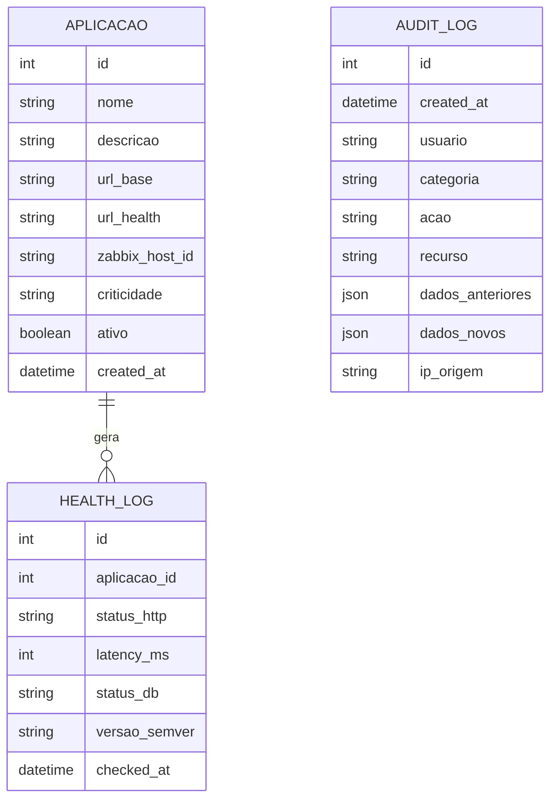

# Modelo de Dados e Dicionário - Monitora USID

## 1. Modelo Entidade-Relacionamento


## 2. Dicionário de Dados
* Tabelas Principais: `APLICACOES`, `HEALTH_LOGS`, `REFRESH_TOKENS`, `AUDIT_LOGS`.

### [SCHEMA] Esquema JSON - Aplicacao
```json
{
  "$schema": "http://json-schema.org/draft-07/schema#",
  "title": "Aplicacao",
  "type": "object",
  "properties": {
    "nome": { "type": "string", "minLength": 2 },
    "descricao": { "type": ["string", "null"] },
    "url_base": { "type": "string", "format": "uri" },
    "url_health": { "type": "string" },
    "zabbix_host_id": { "type": ["string", "null"] },
    "criticidade": { "type": "string", "enum": ["ALTA", "MEDIA", "BAIXA"] },
    "ativo": { "type": "boolean" }
  },
  "required": ["nome", "url_base", "url_health", "criticidade"]
}
```

### [SCHEMA] Esquema JSON - HealthLog
```json
{
  "$schema": "http://json-schema.org/draft-07/schema#",
  "title": "HealthLog",
  "type": "object",
  "properties": {
    "aplicacao_id": { "type": "integer" },
    "status_http": { "type": "integer" },
    "latency_ms": { "type": "integer" },
    "status_db": { "type": "string" },
    "versao_semver": { "type": ["string", "null"] },
    "checked_at": { "type": "string", "format": "date-time" }
  },
  "required": ["aplicacao_id", "status_http", "latency_ms"]
}
```

## 3. Regras de Integridade
* Trilha de auditoria em `audit_logs` para criação, alteração ou desativação de aplicações monitoradas.
* Retenção de logs de health configurável.
